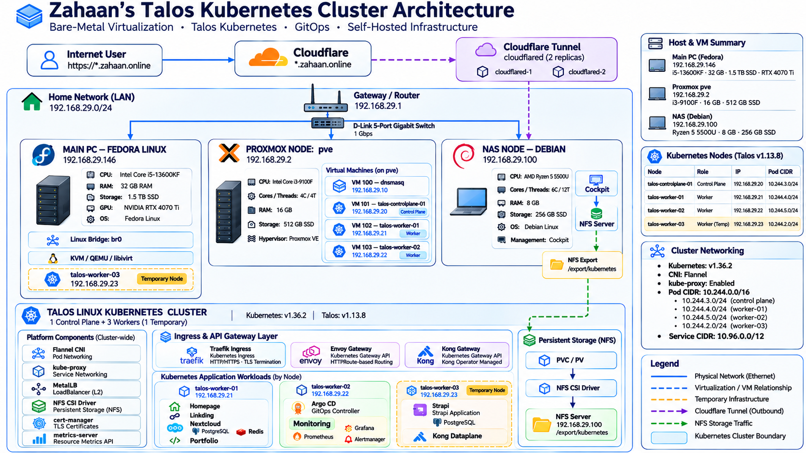

# Homelab Kubernetes Platform

A self-hosted Kubernetes platform built on **Proxmox VE and Talos Linux**, managed through declarative configuration, Helm, Terraform, and GitOps.

This repository serves as both a production-style homelab and a practical Kubernetes/CKA learning environment.

## Architecture

```text
                 Internet
                    |
              Cloudflare DNS
                    |
          +---------+----------+
          |                    |
    Cloudflare Tunnel     MetalLB / Gateway
          |                    |
          +---------+----------+
                    |
             Talos Kubernetes
                v1.36.2
                    |
        +-----------+-----------+
        |           |           |
    Control Plane  Worker 01  Worker 02
        |           |           |
        +-----------+-----------+
                    |
          +---------+---------+
          |                   |
        Argo CD         Platform Services
          |                   |
    +-----+------+       +----+------+
    |            |       |           |
 Infrastructure Apps  Homepage  Monitoring
```

<div align="center">
  
</div>

## Infrastructure Stack

| Layer | Technology |
|---|---|
| Virtualization | Proxmox VE |
| Kubernetes OS | Talos Linux |
| Kubernetes | v1.36.2 |
| Container Runtime | containerd |
| CNI | Flannel |
| Load Balancing | MetalLB |
| Gateway / Ingress | Gateway API, Traefik |
| TLS | cert-manager, Let's Encrypt |
| DNS / Edge | Cloudflare, DNSMASQ |
| Tunnel | cloudflared |
| Storage | NFS CSI |
| GitOps | Argo CD |
| Packaging | Helm |
| Infrastructure as Code | Terraform |

## Cluster Nodes

| Node | Role | IP |
|---|---|---|
| `talos-controlplane-01` | Control Plane | `192.168.29.20` |
| `talos-worker-01` | Worker | `192.168.29.21` |
| `talos-worker-02` | Worker | `192.168.29.22` |
| `talos-worker-03` | Worker | `192.168.29.23` |

**Networking**

```text
LAN:             192.168.29.0/24
Gateway:         192.168.29.1
DNSMASQ:         192.168.29.10

Pod CIDR:        10.244.0.0/16
Service CIDR:    10.96.0.0/12

Kubernetes API:  https://192.168.29.20:6443
```

The cluster uses a single control plane and is intended for homelab workloads and learning.

## Repository Structure

```text
homelab/
├── assets/                 Architecture diagrams
├── docs/                   Setup and operational guides
├── kubernetes/
│   ├── applications/       Application Helm charts
│   ├── argocd/             GitOps configuration
│   ├── infrastructure/     Networking, security, storage
│   └── platform/           Shared platform services
├── labs/                   CKA learning exercises
├── proxmox/                Terraform configuration
├── scripts/                Helper scripts
├── talos/                  Talos configuration
└── README.md
```

## GitOps

Argo CD manages Kubernetes resources through declarative Git configuration.

```text
Git Repository
      |
      v
   Argo CD
      |
      +-- Infrastructure
      |
      +-- Platform Services
      |
      +-- Applications
      |
      v
Kubernetes Cluster
```

**Workflow:** Commit changes to Git → Argo CD reconciles the cluster → Kubernetes reaches the declared state.

## Storage

Persistent application data is provided through an external NAS using the NFS CSI driver.

```text
Application → PVC → StorageClass → NFS CSI → NAS
```

See [NFS CSI Integration](docs/Kubernetes-NFS-CSI-Integration.md).

## Networking and TLS

- **MetalLB:** LoadBalancer IP allocation.
- **Gateway API:** Kubernetes traffic routing.
- **cert-manager:** Automated TLS certificates.
- **Cloudflare:** DNS and external edge services.
- **cloudflared:** Tunnel-based external access.
- **DNSMASQ** Internal DNS resolution.

## Applications

Current application workloads:

| Application | Purpose |
|---|---|
| Linkding | Bookmark management |
| Nextcloud | Personal cloud and file management |
| Portfolio | Personal portfolio website |

## Platform Services

| Service | Purpose |
|---|---|
| Argo CD | GitOps and application management |
| Homepage | Internal dashboard |
| Monitoring | Cluster observability |

## CKA Labs

The `labs/` directory contains practical Kubernetes exercises covering:

- Pods and ReplicaSets
- Deployments and DaemonSets
- Scheduling and affinity
- ConfigMaps and Secrets
- Storage and persistent volumes
- Networking and services
- Troubleshooting

Labs are maintained separately from platform manifests to keep learning experiments isolated.

## Documentation

Detailed setup and operational guides are maintained in `docs/`.

- [Architecture](docs/Architecture.md)
- [Proxmox Setup](docs/Proxmox-Homelab-Setup.md)
- [NAS Setup](docs/NAS-Setup.md)
- [NFS CSI Integration](docs/Kubernetes-NFS-CSI-Integration.md)
- [MetalLB Setup](docs/MetalLB-Setup.md)
- [Kubernetes TLS](docs/Kubernetes-TLS.md)
- [Internal DNS](docs/Internal-DNS.md)

See the [Kubernetes documentation](kubernetes/README.md), [Talos configuration](talos/README.md), and [Proxmox configuration](proxmox/README.md) for implementation details.

## Security

Never commit sensitive configuration, including:

- Talos secrets and credentials
- Kubernetes admin credentials
- API tokens and passwords
- Cloudflare tunnel tokens
- Private keys
- Terraform state containing secrets
- Sensitive `.tfvars` files

## Project Goals

This homelab focuses on developing practical skills in:

**Kubernetes · CKA · Talos Linux · Proxmox · GitOps · Helm · Terraform · Networking · Gateway API · TLS · Storage · Observability · Platform Engineering**

---

*An evolving homelab focused on building, operating, and understanding a Kubernetes platform through hands-on engineering.*
